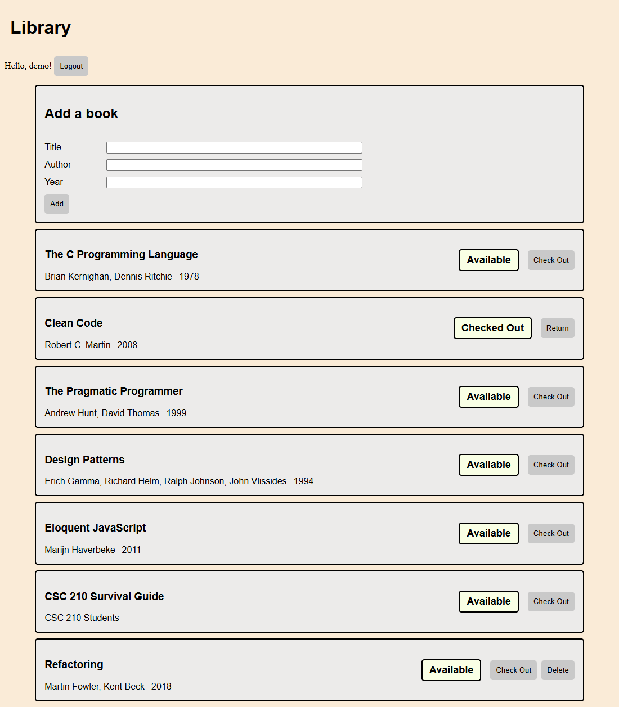

# Library App

A full-stack library catalog. Anyone can browse the books. Signed-in users can add books, check them out and return them, and delete books they added.



## Features

- Accounts with registration and login. Passwords are hashed with bcrypt, and sessions use a JWT stored in an httpOnly cookie.
- Public book list. Logged-in users can add books and check them out or return them.
- Only the user who added a book can delete it. The server enforces this, and the delete button only appears for that user.
- The server validates input and returns clear error messages, which the UI displays.
- If a session expires mid-action, the UI signs the user out and asks them to log in again.

## Tech stack

| Part     | Tools                                         |
| -------- | --------------------------------------------- |
| Frontend | React 19, Vite                                |
| Backend  | Node.js, Express 5                            |
| Database | SQLite via Sequelize (seeded on first run)    |
| Auth     | bcrypt, jsonwebtoken, cookie-parser           |

## Getting started

You need Node.js 20.19+ or 22.12+.

### 1. Start the API server

```bash
cd server
npm install
```

Copy `server/.env.example` to `server/.env` and set `JWT_SECRET` to a long random string. Login fails without it. To generate one:

```bash
node -e "console.log(require('crypto').randomBytes(32).toString('hex'))"
```

Then start the server from inside the `server` folder:

```bash
node server.js
```

The API runs at http://localhost:3000. On first start it creates `server/database/library.db` and seeds it from `database/seed/books.json`.

### 2. Start the client

In a second terminal:

```bash
cd client
npm install
npm run dev
```

Open http://localhost:5173 and sign up to add books. The server's CORS settings only allow this origin, so keep the client on port 5173.

## API

| Method | Path                | Auth             | Description                                 |
| ------ | ------------------- | ---------------- | ------------------------------------------- |
| GET    | `/api/books`        | none             | List books (`?checked_out=true` to filter)  |
| GET    | `/api/books/:id`    | none             | Get one book                                |
| POST   | `/api/books`        | logged in        | Add a book (`title`, `authors[]`, `year?`)  |
| PUT    | `/api/books/:id`    | logged in        | Check out or return (`checked_out: bool`)   |
| DELETE | `/api/books/:id`    | owner only       | Delete a book you added                     |
| POST   | `/api/register`     | none             | Create an account (8+ character password)   |
| POST   | `/api/login`        | none             | Log in and receive the session cookie       |
| POST   | `/api/logout`       | none             | Clear the session cookie                    |
| GET    | `/api/me`           | logged in        | Get the current user                        |

## Project structure

```
client/                React app (Vite)
  src/features/auth/   Login and sign-up form
  src/features/books/  Book list and add-book form
server/
  server.js            Express routes
  middleware/auth.js   JWT cookie check
  validators/books.js  Input validation for new books
  database/            Sequelize models and seed data
  tests/test_auth.py   Smoke test for the auth flow (Python, needs `requests`)
```
